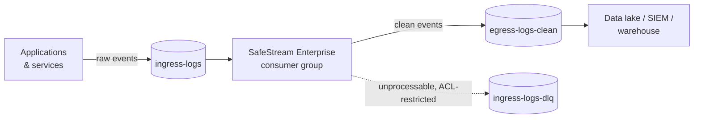

# SafeStream Enterprise

**Stop sensitive data at the pipe, before it lands in your data lake.**

SafeStream Enterprise redacts personal data, payment data and credentials from your log and
event streams *in flight*: between the services that produce them and the warehouses, SIEMs
and data lakes that keep them for years. Raw records come in and clean records go out.
Nothing sensitive reaches the place where it would become a breach, an audit finding or a
GDPR erasure request.

It is the commercial edition of [SafeStream-Redactor](https://github.com/MounishSenisetty/SafeStream-Redactor),
the open-source streaming redaction engine. It adds structure-aware redaction for JSON
and XML records, native Kafka integration, and production deployment manifests.

---

## The problem

Every enterprise data estate has the same leak. An engineer logs a request body to debug an
incident. A payment service logs a customer record on error. An auth proxy forwards headers.
Within hours that data is copied to Kafka, S3, Snowflake, Splunk and three backup tiers, and
each copy is in scope for PCI-DSS, HIPAA and GDPR.

Fixing it after the fact means finding and rewriting every copy. SafeStream Enterprise fixes
it once, at ingestion.

## What you get

| | |
|---|---|
| **Breach prevention at the source** | Passwords, tokens, API keys, card numbers, SSNs, emails, phone numbers and names are removed before data is persisted, so a compromised log store holds nothing worth stealing. |
| **Out-of-the-box compliance coverage** | Built-in field rules cover the data classes named by PCI-DSS, the HIPAA Safe Harbor identifiers, and GDPR personal data. No regex writing is needed on day one. |
| **Accurate on structured data** | Each JSON or XML record is parsed and redacted by field name *and* by content. `"LastName": "Smith"` and `<Data Name="TargetUserName">bob</Data>` are caught even though neither value matches a pattern. |
| **Flat memory at any volume** | A 100 GB log file or a topic carrying billions of events runs in the same fixed memory footprint. Volume spikes cannot cause out-of-memory crashes. |
| **Native to your data estate** | It runs as a Kafka consumer group on Kubernetes, scales horizontally with partitions, and writes to a clean topic that your existing sinks (S3, Snowflake, Databricks, Elastic, Splunk) already read. |
| **Your data never leaves your network** | It is fully self-hosted. There is no SaaS round-trip, no vendor cloud and no telemetry. The cluster's network policy limits the pod to your brokers. |
| **Analytics still work** | In pseudonymization mode the same customer always maps to the same token, so joins, counts and fraud models keep working on data that contains no PII. |

## How it works



Every record goes through two independent checks. If either one finds sensitive data, the
data is removed:

1. **Structural rules.** A field whose name indicates sensitive data (`password`, `card_number`,
   `LastName`, `patient_mrn`, ...) has its whole value redacted, including nested objects and
   arrays. Field names are matched regardless of spelling style: `lastName`, `last_name` and
   `LAST-NAME` are treated as the same field. In XML, element names, attribute names, and
   `Name`/`key` attributes (as in Windows Event Log `<Data Name="...">` fields) all count as
   field names.
2. **Content detection.** Every other value is scanned by the open-source engine's detectors
   (validated patterns, checksums, entropy analysis and contextual scoring). This catches
   secrets hidden in free text, such as `"msg": "retrying with key AKIA..."`.

The format is detected per record: a record whose first character is `<` is handled as
XML, anything else as JSON. Records that are neither are never passed through unchecked.
By default the Kafka connector sends them to the dead-letter topic. You can choose to have them text-redacted
and delivered to the clean topic instead.

**Delivery guarantees.** No record reaches the clean topic unredacted, and a record that cannot
be processed goes to an access-restricted dead-letter topic, never to the clean one. Two modes:

- **At-least-once** (default). Offsets are committed only after the clean topic acknowledges the
  data, so a crash replays records and never drops them. Duplicates are possible after a crash.
- **Exactly-once.** Each batch of clean records, dead-letter records and consumer offsets
  commits as one Kafka transaction, so a crash can neither drop nor duplicate a record.
  Downstream consumers must read the clean topic with `isolation.level=read_committed`.

## Why SafeStream Enterprise vs. legacy DLP

Legacy DLP was built to scan email gateways, endpoints and file shares on a schedule.
Streaming data estates need prevention inline, at machine speed, inside your own
infrastructure.

| | Legacy DLP suites | Cloud DLP APIs | **SafeStream Enterprise** |
|---|---|---|---|
| **When data is protected** | After it is stored (scheduled scans) | Per API call, if every producer calls it | **Inline, before anything is stored** |
| **Where your data goes** | Vendor appliance or agent | Sent to the vendor's cloud for inspection | **Never leaves your network** |
| **Structured logs (JSON, XML)** | Treated as flat text; field context lost | Partial, per-API schema work | **Field-aware: redacts by key and by content** |
| **Memory at 100 GB+** | Grows with input; large files skipped or chunked by hand | Request-size limits | **Constant, independent of volume** |
| **Secrets & credentials** | PII-focused; API keys rarely covered | Limited | **Cloud keys, tokens, JWTs, private keys, high-entropy secrets** |
| **Kafka / streaming** | Not supported, or requires custom glue | Custom glue per pipeline | **Native consumer group** |
| **Analytics on protected data** | Data blocked or quarantined | Tokenization often costs extra | **Consistent keyed pseudonyms keep joins working** |
| **Cost model** | Per-endpoint / per-seat licensing | Per-GB inspection fees that grow with volume | **Self-hosted; your compute, no per-GB fees** |
| **Auditability** | Black-box rules | Black-box models | **Open-source core you can read and test; content-free run reports** |
| **Time to deploy** | Months of policy tuning | Weeks of producer changes | **One `kubectl apply`; no producer changes** |

## Compliance coverage

Built-in field rules and detectors map to the data classes these frameworks regulate.
SafeStream is a technical control that helps you meet these requirements. Certification
remains a property of your environment and your audit.

| Framework | Data classes covered out of the box | Typical control |
|---|---|---|
| **PCI-DSS v4.0** | Primary account numbers (Luhn-validated), CVV/CVC fields, card-number fields | Req. 3: protect stored account data; keep logs out of CDE scope |
| **HIPAA** | Names, phone/fax, email, SSN, medical record numbers, health-plan and insurance IDs, dates of birth, addresses, IPs | Safe Harbor de-identification (§164.514(b)) |
| **GDPR** | Names, contact data, online identifiers, national IDs | Art. 25 data protection by design; Art. 32 pseudonymization |
| **SOC 2** | Passwords, API keys, tokens, private keys, session cookies | CC6.1 logical access, CC6.7 data in transmission |

The Kafka connector publishes **content-free audit events**: per-window counts of what was
redacted, by entity type, together with the delivery mode, redaction mode and a fingerprint of
the field rules in force. They never contain the redacted values. You can file them as audit
evidence without creating a new sensitive artifact. See
[Compliance audit events](#compliance-audit-events).

## Deploy in minutes

**Kubernetes (recommended).** With Helm, after creating the namespace and Secret below:

```bash
helm install safestream deploy/helm/safestream-enterprise --namespace safestream \
  --set kafka.bootstrapServers=broker-1:9092
```

Every setting, with its default, is documented in the chart's
[`values.yaml`](deploy/helm/safestream-enterprise/values.yaml). Without Helm, apply the
manifest rendered from the same chart with its default values:

```bash
kubectl create namespace safestream
```

```bash
kubectl -n safestream create secret generic safestream-secrets \
  --from-literal=hmac-key="$(openssl rand -hex 32)" \
  --from-literal=sasl-username=svc-safestream --from-literal=sasl-password='...'
```

```bash
kubectl apply -f deploy/kubernetes/kafka-redactor.yaml
```

Point your data-lake sinks at `egress-logs-clean`. Producers do not need any changes.

The chart runs three replicas spread across nodes and zones, with a PodDisruptionBudget so
node drains take one at a time, and passes the `restricted` Pod Security Standard. Optional
parts, each one value to switch on:

| Value | What it adds |
|---|---|
| `autoscaling.enabled` | Scales replicas on consumer lag with [KEDA](https://keda.sh), between `minReplicas` and `maxReplicas` (keep that at or below the partition count) |
| `prometheusRule.enabled` | Alert rules for the Prometheus Operator (also rendered to `deploy/kubernetes/prometheus-rules.yaml`) |
| `dashboard.enabled` | A Grafana dashboard as a ConfigMap for Grafana's sidecar: throughput, redactions by type, lag, latency percentiles |
| `audit.topic` | Compliance audit events |

**Docker:**

```bash
docker run --rm -e KAFKA_BOOTSTRAP_SERVERS=broker:9092 safestream-enterprise
```

**Backfill the data lake** with `safestream-batch`. It redacts NDJSON, or one XML record
per line, from files, directory trees or stdin in constant memory. It uses the same rules,
mode and HMAC key as the connector, so backfilled records get the same pseudonyms as
streamed ones and stay joinable:

```bash
safestream-batch lake/raw/ -o lake/clean/ --rules field-rules.json --report report.json
```

```bash
aws s3 cp s3://lake/raw/app.ndjson.gz - | gunzip | safestream-batch - | gzip | aws s3 cp - s3://lake/clean/app.ndjson.gz
```

- **One record per line.** Directory trees are mirrored into the output directory, including
  `*.ndjson`, `*.jsonl` and `*.log`, plain or `.gz`; change the selection with `--include`.
  Each line must be a whole JSON or XML record. A pretty-printed, multi-line `.json` or `.xml`
  document has no line that parses on its own, so it gets only text redaction and the field
  rules don't apply. The run logs a warning when that happens, and the report counts it as
  `text_fallback_lines`. Flatten such files first, for example with `jq -c .`.
- **No silent overwrites.** Two inputs that would write the same output path are refused.
- **Object storage.** `-` reads stdin and writes stdout, so any CLI that streams objects works
  without an SDK.
- **Safe writes.** Each output is written to a temporary file, fsynced, then renamed into place,
  so a crash never leaves a half-redacted file. Outputs are created mode 0600, and line endings
  and blank lines are kept.
- **Content-free report.** `--report` writes counts by entity type, lines processed, how many
  lines fell back to text redaction, and the rule fingerprint.
- **Secrets.** `SAFESTREAM_HMAC_KEY` comes from the environment, never from an argument, which
  other users could see in the process list.
- **In the container image:**
  `docker run -i --entrypoint /usr/bin/python3 ghcr.io/mounishsenisetty/safestream-enterprise:0.3.0 -m safestream_enterprise.batch -`.

**Python library** (Spark UDFs, custom services):

```python
from safestream_enterprise import StructuredRedactor

redactor = StructuredRedactor()
redactor.redact_line('{"LastName": "Smith", "msg": "contact bob@corp.example"}').text
# '{"LastName":"[REDACTED]","msg":"contact [REDACTED]"}'

redactor.redact_line('<user><Phone>555 0100</Phone><param key="password" value="x"/></user>').text
# '<user><Phone>[REDACTED]</Phone><param key="password" value="[REDACTED]"/></user>'

with open("app.ndjson") as src, open("app.clean.ndjson", "w") as dst:
    for line in redactor.redact_lines(src):  # streams; memory stays flat
        dst.write(line + "\n")
```

### Configuration

| Variable | Default | Purpose |
|---|---|---|
| `KAFKA_BOOTSTRAP_SERVERS` | *(required)* | Broker list |
| `KAFKA_GROUP_ID` | `safestream-redactor` | Consumer group, shared by all replicas |
| `INGRESS_TOPIC` / `EGRESS_TOPIC` | `ingress-logs` / `egress-logs-clean` | Source and destination |
| `DLQ_TOPIC` | `ingress-logs-dlq` | Unprocessable records (restrict its ACLs like the ingress topic) |
| `SAFESTREAM_MODE` | `replace` | `replace`, `mask` or `pseudonymize` |
| `SAFESTREAM_HMAC_KEY` | none | Key for consistent pseudonyms (mount from a Secret) |
| `SAFESTREAM_UNPARSEABLE` | `dlq` | Payloads that are neither JSON nor XML. `dlq`: send them to the DLQ. `redact_text`: text-redact them and deliver them to egress |
| `SAFESTREAM_DELIVERY` | `at_least_once` | `at_least_once` or `exactly_once` (one transaction per batch; needs transactional-ID write permission on the brokers) |
| `SAFESTREAM_FIELD_RULES_FILE` | none | JSON file of customer field rules, usually a mounted ConfigMap. See [Custom field rules](#custom-field-rules) |
| `SAFESTREAM_POLICY_FILE` | none | Signed policy bundle, used in place of the rules file and re-read while running. See [Signed policy bundles](#signed-policy-bundles) |
| `SAFESTREAM_POLICY_PUBLIC_KEYS` | none | Keys whose signature is trusted: comma-separated base64, from `safestream-policy keygen`. Required with the policy file |
| `SAFESTREAM_POLICY_TENANT` | none | Refuse bundles for any other tenant |
| `SAFESTREAM_POLICY_MIN_VERSION` | `1` | Refuse bundles below this version |
| `SAFESTREAM_POLICY_RELOAD_S` | `30` | How often the bundle file is checked for a newer version |
| `SAFESTREAM_SHADOW_POLICY_FILE` | none | Candidate bundle to evaluate in shadow; the file may be absent. See [Shadow mode](#shadow-mode-try-a-policy-before-it-applies) |
| `SAFESTREAM_SHADOW_SAMPLE_EVERY` | `1` | Shadow every Nth record. Each shadowed record is redacted a second time |
| `SAFESTREAM_AUDIT_TOPIC` | none | Topic for compliance audit events; unset turns auditing off. See [Compliance audit events](#compliance-audit-events) |
| `SAFESTREAM_AUDIT_INTERVAL_S` | `60` | Seconds per audit window (minimum 1) |
| `SAFESTREAM_METRICS_PORT` | `9400` | Port for `/healthz`, `/readyz` and `/metrics`; `0` turns the endpoint off. See [Monitoring](#monitoring) |
| `SAFESTREAM_LIVENESS_TIMEOUT_S` | `120` | Once the main loop hasn't advanced for this long, `/healthz` fails and the connector exits with code 3 to be restarted. Must be at least twice `SAFESTREAM_FLUSH_TIMEOUT_S` |
| `SAFESTREAM_TRANSACTIONAL_ID` | `<group id>-<hostname>` | Exactly-once only. The default (the pod name on Kubernetes) is unique per instance, which is all exactly-once needs |
| `SAFESTREAM_BATCH_SIZE` | `500` | Records per commit (per transaction in exactly-once mode) |
| `SAFESTREAM_FLUSH_TIMEOUT_S` | `30` | Maximum wait for egress acknowledgements per batch |
| `SAFESTREAM_KAFKA_*` | none | Any Kafka client setting, e.g. `SAFESTREAM_KAFKA_SECURITY_PROTOCOL=SASL_SSL` |
| `LOG_LEVEL` | `INFO` | Standard level name; an unknown name falls back to `INFO` |
| `LOG_FORMAT` | `text` | `text`, or `json` for one JSON object per line. Also applies to `safestream-batch` |

Configuration is validated at startup. A bad value, or a dangerous combination such as the
DLQ topic set to the clean topic, stops the pod immediately with a clear error. Secret values
never appear in logs.

### Custom field rules

The built-in rules cover common PCI, HIPAA and GDPR field names. To add your own schema's
fields, such as `loyalty_number` or a vendor signature header, supply a JSON rules file. No
code change or rebuild is needed. On Kubernetes it's the chart's `fieldRules` value, mounted
read-only from a ConfigMap and named by `SAFESTREAM_FIELD_RULES_FILE`:

```json
{
  "mode": "extend",
  "rules": {
    "*loyalty_number*": "id_number",
    "re:^x-acme-.*-signature$": "secret"
  },
  "disable": ["*login*"]
}
```

- **Patterns.** A glob matches the field name in any spelling style: `*loyalty_number*` matches
  `loyaltyNumber`, `LOYALTY-NUMBER` and `loyalty_number_hash`. A pattern prefixed with `re:` is
  a case-insensitive regular expression matched against the name as written. In XML, element
  names, attribute names and `Name`/`key` attributes all count as field names.
- **`mode: "extend"`** (the default) puts your rules ahead of the built-in ones, so yours win
  where both match. `disable` removes built-in rules by their exact pattern, for a field that
  isn't sensitive in your schema.
- **`mode: "replace"`** uses only your rules.
- **Validated at startup.** An unknown entity type, a misspelled key, an invalid regex, or a
  `disable` entry that matches no built-in rule stops the pod with a clear error rather than
  leaving a field unredacted. The file is read once at startup; the chart rolls the pods when
  `fieldRules` changes, so every replica uses the same rules.

The same rules work from Python:

```python
from safestream_enterprise import StructuredRedactor, load_field_rules

redactor = StructuredRedactor(field_rules=load_field_rules("field-rules.json"))
```

### Signed policy bundles

A rules file is trusted because of where it is mounted: anyone who can edit that ConfigMap can
quietly remove a rule, and redaction weakens with no error. A **policy bundle** is the same
rules with an Ed25519 signature, and the connector obeys only bundles signed by a key you told
it to trust.

```bash
safestream-policy keygen policy-signing.key
```

That writes the private key (mode 0600; keep it off the cluster, in your secret manager) and
prints the public key to put in `SAFESTREAM_POLICY_PUBLIC_KEYS` (the chart's
`policy.publicKeys`). Then, for every change to the rules:

```bash
safestream-policy sign field-rules.json --key policy-signing.key --tenant acme --version 7 -o policy.json
```

```bash
kubectl -n safestream create configmap safestream-policy --from-file=policy.json --dry-run=client -o yaml | kubectl apply -f -
```

- **No restart.** Each connector notices the new file within `SAFESTREAM_POLICY_RELOAD_S` of
  Kubernetes updating the mount (about a minute in all) and switches between two batches, so
  every record is redacted under exactly one version. `safestream_policy_version` shows which.
- **Refused bundles change nothing.** A bundle that is forged or edited after signing, older
  than (or the same version as) the one in force, for another tenant, or carrying invalid
  rules is refused. The policy in force stays in force, the refusal is logged without quoting
  any rule, `safestream_policy_rejections_total` increases, and the `SafeStreamPolicyRefused`
  alert fires. At startup a refused bundle stops the pod, as a bad rules file does.
- **Rollback floor.** Versions are compared while a connector runs. A restarted connector
  accepts any trusted bundle at or above `SAFESTREAM_POLICY_MIN_VERSION`, so raise that when
  you retire a policy and an old signed bundle cannot be put back.
- **Key rotation.** A bundle may carry several signatures and several keys may be trusted:
  trust the new key everywhere, then sign with it, then drop the old key.
- **Evidence.** Audit events name the policy tenant, version and signing key, and a policy
  change closes the audit window, so each event covers records redacted under one policy.
- **Backfills.** `safestream-batch --policy policy.json` verifies the bundle the same way.
- **Check before publishing.** `safestream-policy verify policy.json` applies the connector's
  checks and prints the tenant, version, signing key and rule count.

The signature moves trust from "who can edit the ConfigMap" to "who holds the signing key and
who can change the connector's trusted keys". Keep the trusted keys in configuration that is
reviewed (the chart values in Git), not next to the bundle.

### Shadow mode: try a policy before it applies

A rule change is a guess until it meets real traffic: it may miss the field it was written
for, or redact one your analysts need. Shadow mode answers that before anything changes, and
without anyone looking at the data. Put the signed candidate next to the policy as
`candidate.json` (the same ConfigMap on Kubernetes):

```bash
safestream-policy sign new-rules.json --key policy-signing.key --tenant acme --version 8 -o candidate.json
```

Each connector then redacts every sampled record twice: once under the policy in force, which
is what gets published, and once under the candidate, which is discarded. It reports the
difference as counts, in `/metrics` and in every audit event:

```json
"shadow": {
  "candidate": {"tenant": "acme", "version": 8, "key_id": "9a41c0de52b7f310"},
  "since": "2026-11-11T09:00:00+00:00",
  "records": 48210,
  "changed_records": 4100,
  "errors": 0,
  "redactions": {
    "active": {"email": 9120, "person": 4471},
    "candidate": {"email": 9120, "id_number": 4100, "person": 4471}
  }
}
```

Read it as: of 48,210 records, 4,100 would come out differently; the candidate adds 4,100
`id_number` redactions and loses none of what is caught today. A type whose count *drops*
under the candidate is the thing to look for before promoting.

- **Promote** by publishing the same signed file as `policy.json`. Connectors adopt it and
  the comparison ends by itself. **Withdraw** by removing `candidate.json`.
- **A candidate never touches output.** It needs a trusted signature like any bundle; one
  that is refused, or that fails on a record, is counted and changes nothing.
- **Cost.** A shadowed record is redacted twice. `SAFESTREAM_SHADOW_SAMPLE_EVERY=10` shadows
  one record in ten.
- **Scope.** Record values are compared. Keys and headers are not, since field rules do not
  apply to them.

### Compliance audit events

With `SAFESTREAM_AUDIT_TOPIC` set, every connector instance publishes one event per window
(`SAFESTREAM_AUDIT_INTERVAL_S`, default 60s), so evidence of what the pipeline removed comes
from the pipeline itself rather than from scraping logs or keeping metrics for years:

```json
{
  "schema": "safestream.audit/v2",
  "connector_version": "0.3.0",
  "instance": "safestream-kafka-redactor-7d9f8-x2k4q",
  "group_id": "safestream-redactor",
  "topics": {"ingress": "ingress-logs", "egress": "egress-logs-clean", "dlq": "ingress-logs-dlq"},
  "delivery": "exactly_once",
  "redaction_mode": "pseudonymize",
  "field_rules": {"count": 68, "fingerprint": "sha256:3f1c…"},
  "policy": {"tenant": "acme", "version": 7, "key_id": "9a41c0de52b7f310"},
  "shadow": null,
  "chain": {"id": "safestream-kafka-redactor-7d9f8-x2k4q-20261105T115900000000Z", "seq": 1, "prev": "sha256:8c2e…"},
  "window": {"start": "2026-11-05T12:00:00.000+00:00", "end": "2026-11-05T12:01:00.000+00:00", "final": false},
  "records": {"egress": 48210, "dlq": 3},
  "redactions": {"email": 9120, "person": 4471, "secret": 37},
  "batches": 97,
  "transaction_aborts": 0
}
```

- **Content-free.** An event holds counts, entity-type names and configuration, never record
  values. The field rules appear as a fingerprint (a SHA-256 of the exact rule table, order
  included), which proves which rule set applied without revealing it.
- **No gaps.** A window closes only when its event is acknowledged. If a send fails, the
  failure is logged and counted in `safestream_audit_failures_total`, and the next event covers
  the whole period. A final event closes the window on shutdown. Empty windows are reported
  too, since "nothing processed" is evidence as well.
- **Tamper-evident.** Each event names its place in a hash chain: `chain.prev` is the SHA-256
  of the previous event exactly as published. One chain covers one run of one connector; a
  restart starts a new one. Export the topic and check it:

  ```bash
  safestream-audit verify audit.ndjson --require-closed
  ```

  It reports any event that was altered, removed, reordered or replayed, and prints each
  chain's `head`. A chain alone cannot show that its last events, or the whole chain, were
  deleted, or that someone able to rewrite every copy rebuilt it. Record the heads somewhere
  the audit store's administrators cannot write, and check later with
  `--head <chain id>=<hash>`. `--require-closed` also fails a chain that does not end with a
  clean shutdown, which is either a crash or missing final events.
- **Never blocks redaction.** An audit failure doesn't stop the pipeline. In exactly-once mode
  each event is its own small transaction.
- **Setup.** Create the topic with the retention your audit policy needs, and grant the
  connector's account Write on it. Events are keyed by instance, so each pod's events stay in
  order.

### Replaying the dead-letter topic

Dead-lettered records are the original, unredacted records. Once the cause is fixed (a
producer bug, a topic size limit), `safestream-dlq` sends them back to the **ingress** topic,
never to the clean one, so they go through redaction like any other record:

```bash
safestream-dlq summary
```

```bash
safestream-dlq replay --error MSG_SIZE_TOO_LARGE --limit 1000
```

- **`summary`** prints counts by error name (`{"records": 3, "by_error": {...}}`) and changes
  nothing.
- **`replay`** reads to the current end of the DLQ, waits for the brokers to acknowledge every
  replayed record, then commits its position under `--group` (default
  `<KAFKA_GROUP_ID>-dlq-replay`). A crash before that repeats the run; the next run continues
  where this one stopped. Records an `--error` filter passes over are not revisited by the
  same group; use another `--group` to replay them later.
- It reads the connector's own environment variables, so on Kubernetes run it from the same
  image and Secret: `python3 -m safestream_enterprise.dlq replay`.

### Monitoring

The connector serves three endpoints on `SAFESTREAM_METRICS_PORT` (default 9400). The
Kubernetes manifest wires them up as probes and for Prometheus scraping.

| Endpoint | Meaning |
|---|---|
| `/healthz` | Liveness. Fails only if the main loop stops advancing (a wedged process), so Kubernetes restarts it. A broker outage does **not** fail it, because a restart can't fix the brokers. |
| `/readyz` | Readiness. Passes once the connector has subscribed; fails during shutdown. |
| `/metrics` | Prometheus text format. |

| Metric | Type | Description |
|---|---|---|
| `safestream_records_total{destination="egress"\|"dlq"}` | counter | Records published to the clean and dead-letter topics |
| `safestream_redactions_total{entity_type="..."}` | counter | Values redacted, by entity type: compliance evidence of what the pipeline removed |
| `safestream_batches_total` | counter | Batches committed |
| `safestream_transaction_aborts_total` | counter | Aborted transactions (exactly-once); a sustained rate points at broker trouble |
| `safestream_audit_events_total` | counter | Audit events delivered |
| `safestream_audit_failures_total` | counter | Audit events not delivered; the window is carried into the next event |
| `safestream_batch_duration_seconds` | histogram | Time to redact, publish and commit one batch |
| `safestream_record_duration_seconds` | histogram | Time to redact one record and hand it to the producer |
| `safestream_consumer_lag_records` | gauge | Records not yet consumed on this instance's partitions, as of its last fetch. Absent until it has a position |
| `safestream_assigned_partitions` | gauge | Ingress partitions assigned to this instance |
| `safestream_policy_version` | gauge | Version of the signed policy in force (only with a policy bundle) |
| `safestream_policy_rejections_total` | counter | Policy bundles refused: bad signature, rollback, wrong tenant or invalid rules |
| `safestream_shadow_policy_version` | gauge | Candidate policy being evaluated in shadow (only while one is) |
| `safestream_shadow_records_total` | counter | Records also redacted under the candidate |
| `safestream_shadow_changed_records_total` | counter | Records whose output would differ under the candidate |
| `safestream_shadow_redactions_total{policy="active"\|"candidate",entity_type="..."}` | counter | Redactions on shadowed records under each policy |
| `safestream_heartbeat_age_seconds` | gauge | Seconds since the main loop last advanced |
| `safestream_ready` | gauge | 1 while consuming |

Ready-made alerts for these metrics are in `deploy/kubernetes/prometheus-rules.yaml`: no
replica consuming, a stalled main loop, a sustained `dlq` rate (producers sending malformed
records), repeated transaction aborts, and undelivered audit events. The connector reports
lag on the partitions it is consuming; lag on partitions nobody is consuming (every pod down) comes from your usual Kafka exporter,
for example kafka-exporter or Burrow, under group `KAFKA_GROUP_ID`.

The endpoint carries counts only, never record content, keys or headers, and it never logs
requests. The NetworkPolicy lets only the `monitoring` namespace reach the port.

## Security model

- **Fail closed.** A record that is neither JSON nor XML, or that fails processing, goes to the restricted
  DLQ while the consumer keeps running. If the brokers fail to acknowledge a batch, the
  consumer exits without committing offsets, and Kubernetes restarts it from the last safe
  point. In none of these cases does an unredacted record reach the clean topic.
- **No silent stalls.** A Kafka client call can block far past its own timeout after a broker
  crash. A watchdog exits the process (code 3) when the main loop has not advanced for
  `SAFESTREAM_LIVENESS_TIMEOUT_S`, so it is restarted and resumes from the last committed
  offset, with or without Kubernetes probing it. Exit codes: 0 clean stop, 1 Kafka error,
  2 invalid configuration, 3 stalled.
- **No poison pills.** A record the clean topic itself rejects for good (too large once
  redacted, or a timestamp the topic refuses) would fail again on every replay. Its original
  goes to the DLQ instead, tagged with the broker's error name (for example
  `MSG_SIZE_TOO_LARGE`), and the consumer moves on. Records the broker rejected in the same
  produce batch go with it. Transient failures are never dead-lettered.
- **Hostile XML is refused.** Any XML document with a DTD is treated as malformed, which
  blocks entity-expansion bombs and external-entity (XXE) file reads and requests, in every
  encoding. Nesting depth is capped at 254 levels for both JSON and XML.
- **Keys and headers too.** Kafka message keys and header values are redacted, because
  user-ID partition keys and forwarded auth headers leak data as well.
- **No content in logs.** Operational logs carry topic, partition, offset and counts, never
  payloads. The DLQ records only the exception class, never its message.
- **Hardened runtime.** The image is distroless: no shell, no package manager. The container
  runs as non-root on a read-only root filesystem with all Linux capabilities dropped. A
  default-deny NetworkPolicy allows egress only to the Kafka brokers (port 9092) and DNS, and
  ingress only from the `monitoring` namespace to the metrics port.
- **Rules that cannot be quietly weakened.** With a signed policy bundle, a change to the
  field rules takes effect only if it carries a trusted signature and a newer version.
- **No plugin code by default.** Third-party detector plugins are disabled in the service.
- **Verifiable supply chain.** The image installs its Python dependencies from a lock file
  (`requirements.txt`) that pins every version and checks every wheel's hash. CI audits the
  lock file for known vulnerabilities and scans the built image, on every change and weekly.
  GitHub Actions are pinned to commit SHAs. Release images carry an SBOM and build provenance
  and are signed with cosign; see [Verifying a release](#verifying-a-release).

## Repository layout

```
SafeStream-Enterprise/
├── pyproject.toml                      # depends on safestream-redactor (OSS core)
├── requirements.txt                    # hash-pinned lock file the image installs from
├── Dockerfile                          # distroless, non-root connector image
├── deploy/
│   └── kubernetes/
│   ├── helm/safestream-enterprise/     # the chart: source of truth for everything below
│   ├── kubernetes/                     # manifests rendered from the chart by render.sh
│   └── e2e/                            # chart test on a kind cluster (CI)
├── infra/cloudflare/                   # Terraform for safestreamdata.com (see its README)
├── control-plane/                      # the control-plane API: a Cloudflare Worker (see its README)
├── docs/, overrides/, mkdocs.yml       # the public site: landing page + this documentation
├── src/safestream_enterprise/
│   ├── batch.py                        # safestream-batch: backfill files / stdin
│   ├── dlq.py                          # safestream-dlq: summarise and replay the DLQ
│   ├── policy.py                       # safestream-policy: signed policy bundles
│   ├── audit.py                        # safestream-audit: verify the audit hash chain
│   ├── logs.py                         # LOG_LEVEL / LOG_FORMAT for both entry points
│   ├── rules.py                        # custom field rules + the shared redactor factory
│   ├── parsers/
│   │   ├── json_ast.py                 # structure-aware JSON/NDJSON redaction (entry point)
│   │   └── xml_ast.py                  # structure-aware XML redaction, same field rules
│   └── connectors/
│       ├── kafka.py                    # ingress -> redact -> egress consumer group
│       └── health.py                   # /healthz, /readyz, /metrics
└── tests/
```

## Open source and Enterprise

| | SafeStream-Redactor (OSS) | SafeStream Enterprise |
|---|---|---|
| Streaming text redaction, constant memory | ✓ | ✓ |
| PII + credential detectors, redaction modes | ✓ | ✓ |
| CLI, REST, CI/CD gate, pre-commit | ✓ | ✓ (via the OSS core) |
| Structure-aware JSON and XML redaction (field rules) | | ✓ |
| Kafka consumer-group connector | | ✓ |
| Kubernetes deployment & network lockdown | | ✓ |
| Commercial support & SLAs | | ✓ |

## Development

```bash
pip install -e ".[dev]"
```

```bash
pytest && ruff check . && mypy
```

Throughput is measured, not estimated: see [docs/benchmarks.md](docs/benchmarks.md), and run
`python bench/run.py --bootstrap localhost:9092` to reproduce it on your hardware.

Integration tests run against a real broker and, optionally, the built image. They are
skipped unless the environment names a broker. CI runs them against an `apache/kafka`
service container:

```bash
SAFESTREAM_IT_BOOTSTRAP=localhost:9092 SAFESTREAM_IT_IMAGE=safestream-enterprise:ci pytest tests/test_kafka_integration.py
```

Set `SAFESTREAM_IT_KAFKA_CONTAINER` to the broker's Docker container name as well, and the
suite also kills the broker mid-stream and checks that no record is lost or, in exactly-once
mode, duplicated.

After changing dependencies in `pyproject.toml`, regenerate the lock file the image installs
from (Dependabot keeps the pins in it current otherwise):

```bash
uv pip compile pyproject.toml --generate-hashes --python-version 3.13 -o requirements.txt
```

The public site at safestreamdata.com is this README, `SECURITY.md`, `CHANGELOG.md` and
`docs/` built with MkDocs. Preview it locally:

```bash
pip install -e ".[docs]" && mkdocs serve
```

Cloudflare infrastructure is Terraform in `infra/cloudflare`; see
[its README](infra/cloudflare/README.md) for the one-time setup. CI validates it on every
change, and the `Deploy` workflow plans and applies it.

### Releasing

Bump `__version__` in `src/safestream_enterprise/__init__.py` and `version`/`appVersion` in the
chart's `Chart.yaml`, run `deploy/render.sh`, move the `Unreleased` entries in `CHANGELOG.md` under the new version, merge, then push a tag
`v<version>`, or create a GitHub Release with that new tag, which pushes it. The release
workflow:

1. runs the full CI suite on the release commit, including the real-Kafka and container tests;
2. refuses a tag that doesn't match the package version;
3. smoke-tests the image, then pushes `ghcr.io/mounishsenisetty/safestream-enterprise:<version>`
   (and `:<major>.<minor>`) for linux/amd64 and linux/arm64, with an SBOM and build provenance;
4. signs the pushed image digest with cosign;
5. publishes the Helm chart to `oci://ghcr.io/mounishsenisetty/charts/safestream-enterprise`
   and signs it.

Base images are pinned by digest, and Dependabot proposes digest, dependency and action updates
weekly.

### Verifying a release

Images released after 0.3.0 are signed by the release workflow's GitHub identity; there is no key to
distribute. Verify before deploying, or enforce it in the cluster with an admission policy:

```bash
cosign verify ghcr.io/mounishsenisetty/safestream-enterprise:<version> \
  --certificate-oidc-issuer https://token.actions.githubusercontent.com \
  --certificate-identity-regexp '^https://github.com/MounishSenisetty/SafeStream-Enterprise/\.github/workflows/release\.yml@refs/tags/v'
```

## Security

To report a vulnerability, see [SECURITY.md](SECURITY.md). Changes are listed in
[CHANGELOG.md](CHANGELOG.md).
