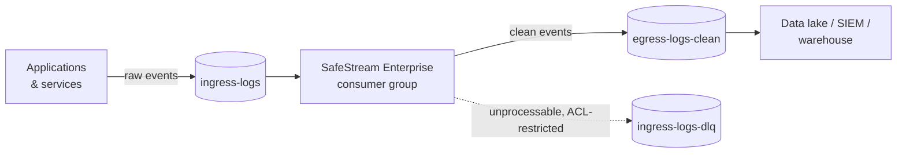

# SafeStream Enterprise

**Stop sensitive data at the pipe, before it lands in your data lake.**

SafeStream Enterprise redacts personal data, payment data and credentials from your log and
event streams *in flight*: between the services that produce them and the warehouses, SIEMs
and data lakes that keep them for years. Raw records come in and clean records go out.
Nothing sensitive reaches the place where it would become a breach, an audit finding or a
GDPR erasure request.

It is the commercial edition of [SafeStream-Redactor](https://github.com/MounishSenisetty/SafeStream-Redactor),
the open-source streaming redaction engine. It adds structure-aware redaction for JSON
records, native Kafka integration, and production deployment manifests.

---

## The problem

Every enterprise data estate has the same leak. An engineer logs a request body to debug an
incident. A payment service logs a customer record on error. An auth proxy forwards headers.
Within hours that data is copied to Kafka, S3, Snowflake, Splunk and three backup tiers, and
each copy is in scope for PCI-DSS, HIPAA and GDPR.

Fixing it after the fact means finding and rewriting every copy. SafeStream Enterprise fixes
it once, at ingestion.

## What you get

| | |
|---|---|
| **Breach prevention at the source** | Passwords, tokens, API keys, card numbers, SSNs, emails, phone numbers and names are removed before data is persisted, so a compromised log store holds nothing worth stealing. |
| **Out-of-the-box compliance coverage** | Built-in field rules cover the data classes named by PCI-DSS, the HIPAA Safe Harbor identifiers, and GDPR personal data. No regex writing is needed on day one. |
| **Accurate on structured data** | Each JSON record is parsed and redacted by field name *and* by content. `"LastName": "Smith"` is caught even though "Smith" matches no pattern. |
| **Flat memory at any volume** | A 100 GB log file or a topic carrying billions of events runs in the same fixed memory footprint. Volume spikes cannot cause out-of-memory crashes. |
| **Native to your data estate** | It runs as a Kafka consumer group on Kubernetes, scales horizontally with partitions, and writes to a clean topic that your existing sinks (S3, Snowflake, Databricks, Elastic, Splunk) already read. |
| **Your data never leaves your network** | It is fully self-hosted. There is no SaaS round-trip, no vendor cloud and no telemetry. The cluster's network policy limits the pod to your brokers. |
| **Analytics still work** | In pseudonymization mode the same customer always maps to the same token, so joins, counts and fraud models keep working on data that contains no PII. |

## How it works



Every record goes through two independent checks. If either one finds sensitive data, the
data is removed:

1. **Structural rules.** A field whose name indicates sensitive data (`password`, `card_number`,
   `LastName`, `patient_mrn`, ...) has its whole value redacted, including nested objects and
   arrays. Field names are matched regardless of spelling style: `lastName`, `last_name` and
   `LAST-NAME` are treated as the same field.
2. **Content detection.** Every other value is scanned by the open-source engine's detectors
   (validated patterns, checksums, entropy analysis and contextual scoring). This catches
   secrets hidden in free text, such as `"msg": "retrying with key AKIA..."`.

Records that are not JSON are never passed through unchecked. By default the Kafka
connector sends them to the dead-letter topic. You can choose to have them text-redacted
and delivered to the clean topic instead.

**Delivery guarantees.** No record reaches the clean topic unredacted. Offsets are committed
only after the clean topic acknowledges the data, so a crash replays records and never drops
them. A record that cannot be processed goes to an access-restricted dead-letter topic and
never to the clean one.

## Why SafeStream Enterprise vs. legacy DLP

Legacy DLP was built to scan email gateways, endpoints and file shares on a schedule.
Streaming data estates need prevention inline, at machine speed, inside your own
infrastructure.

| | Legacy DLP suites | Cloud DLP APIs | **SafeStream Enterprise** |
|---|---|---|---|
| **When data is protected** | After it is stored (scheduled scans) | Per API call, if every producer calls it | **Inline, before anything is stored** |
| **Where your data goes** | Vendor appliance or agent | Sent to the vendor's cloud for inspection | **Never leaves your network** |
| **Structured logs (JSON)** | Treated as flat text; field context lost | Partial, per-API schema work | **Field-aware: redacts by key and by content** |
| **Memory at 100 GB+** | Grows with input; large files skipped or chunked by hand | Request-size limits | **Constant, independent of volume** |
| **Secrets & credentials** | PII-focused; API keys rarely covered | Limited | **Cloud keys, tokens, JWTs, private keys, high-entropy secrets** |
| **Kafka / streaming** | Not supported, or requires custom glue | Custom glue per pipeline | **Native consumer group** |
| **Analytics on protected data** | Data blocked or quarantined | Tokenization often costs extra | **Consistent keyed pseudonyms keep joins working** |
| **Cost model** | Per-endpoint / per-seat licensing | Per-GB inspection fees that grow with volume | **Self-hosted; your compute, no per-GB fees** |
| **Auditability** | Black-box rules | Black-box models | **Open-source core you can read and test; content-free run reports** |
| **Time to deploy** | Months of policy tuning | Weeks of producer changes | **One `kubectl apply`; no producer changes** |

## Compliance coverage

Built-in field rules and detectors map to the data classes these frameworks regulate.
SafeStream is a technical control that helps you meet these requirements. Certification
remains a property of your environment and your audit.

| Framework | Data classes covered out of the box | Typical control |
|---|---|---|
| **PCI-DSS v4.0** | Primary account numbers (Luhn-validated), CVV/CVC fields, card-number fields | Req. 3: protect stored account data; keep logs out of CDE scope |
| **HIPAA** | Names, phone/fax, email, SSN, medical record numbers, health-plan and insurance IDs, dates of birth, addresses, IPs | Safe Harbor de-identification (§164.514(b)) |
| **GDPR** | Names, contact data, online identifiers, national IDs | Art. 25 data protection by design; Art. 32 pseudonymization |
| **SOC 2** | Passwords, API keys, tokens, private keys, session cookies | CC6.1 logical access, CC6.7 data in transmission |

Every run produces **content-free reports**: counts per entity type and record sizes, never
the redacted values. You can file them as audit evidence without creating a new sensitive
artifact.

## Deploy in minutes

**Kubernetes (recommended):**

```bash
kubectl create secret generic safestream-secrets \
  --from-literal=hmac-key="$(openssl rand -hex 32)" \
  --from-literal=sasl-username=svc-safestream --from-literal=sasl-password='...'
```

```bash
kubectl apply -f deploy/kubernetes/kafka-redactor.yaml
```

Point your data-lake sinks at `egress-logs-clean`. Producers do not need any changes.

**Docker:**

```bash
docker run --rm -e KAFKA_BOOTSTRAP_SERVERS=broker:9092 safestream-enterprise
```

**Python library** (batch jobs, Spark UDFs, custom services):

```python
from safestream_enterprise import StructuredRedactor

redactor = StructuredRedactor()
redactor.redact_line('{"LastName": "Smith", "msg": "contact bob@corp.example"}').text
# '{"LastName":"[REDACTED]","msg":"contact [REDACTED]"}'

with open("app.ndjson") as src, open("app.clean.ndjson", "w") as dst:
    for line in redactor.redact_lines(src):  # streams; memory stays flat
        dst.write(line + "\n")
```

### Configuration

| Variable | Default | Purpose |
|---|---|---|
| `KAFKA_BOOTSTRAP_SERVERS` | *(required)* | Broker list |
| `KAFKA_GROUP_ID` | `safestream-redactor` | Consumer group, shared by all replicas |
| `INGRESS_TOPIC` / `EGRESS_TOPIC` | `ingress-logs` / `egress-logs-clean` | Source and destination |
| `DLQ_TOPIC` | `ingress-logs-dlq` | Unprocessable records (restrict its ACLs like the ingress topic) |
| `SAFESTREAM_MODE` | `replace` | `replace`, `mask` or `pseudonymize` |
| `SAFESTREAM_HMAC_KEY` | none | Key for consistent pseudonyms (mount from a Secret) |
| `SAFESTREAM_NON_JSON` | `dlq` | `dlq`: non-JSON payloads go to the DLQ. `redact_text`: they are text-redacted and delivered to egress |
| `SAFESTREAM_BATCH_SIZE` | `500` | Records per commit |
| `SAFESTREAM_FLUSH_TIMEOUT_S` | `30` | Maximum wait for egress acknowledgements per batch |
| `SAFESTREAM_KAFKA_*` | none | Any Kafka client setting, e.g. `SAFESTREAM_KAFKA_SECURITY_PROTOCOL=SASL_SSL` |

Configuration is validated at startup. A bad value, or a dangerous combination such as the
DLQ topic set to the clean topic, stops the pod immediately with a clear error. Secret values
never appear in logs.

Custom field rules, for proprietary schemas. A glob matches the key in any spelling style.
A pattern prefixed with `re:` is a case-insensitive regular expression matched against the
key as written:

```python
from safestream_enterprise import DEFAULT_FIELD_RULES, StructuredRedactor

rules = {
    "*loyalty_number*": "id_number",  # loyaltyNumber, LOYALTY-NUMBER, ...
    "re:^x-.*-signature$": "secret",  # X-Amz-Signature, x-goog-signature
    **DEFAULT_FIELD_RULES,
}
redactor = StructuredRedactor(field_rules=rules)
```

## Security model

- **Fail closed.** A record that is not JSON, or that fails processing, goes to the restricted
  DLQ while the consumer keeps running. If the brokers fail to acknowledge a batch, the
  consumer exits without committing offsets, and Kubernetes restarts it from the last safe
  point. In none of these cases does an unredacted record reach the clean topic.
- **Keys and headers too.** Kafka message keys and header values are redacted, because
  user-ID partition keys and forwarded auth headers leak data as well.
- **No content in logs.** Operational logs carry topic, partition, offset and counts, never
  payloads. The DLQ records only the exception class, never its message.
- **Hardened runtime.** The image is distroless: no shell, no package manager. The container
  runs as non-root on a read-only root filesystem with all Linux capabilities dropped. A
  default-deny NetworkPolicy allows egress only to the Kafka brokers (port 9092) and DNS.
- **No plugin code by default.** Third-party detector plugins are disabled in the service.

## Repository layout

```
SafeStream-Enterprise/
├── pyproject.toml                      # depends on safestream-redactor (OSS core)
├── Dockerfile                          # distroless, non-root connector image
├── deploy/
│   └── kubernetes/
│       └── kafka-redactor.yaml         # Deployment + default-deny NetworkPolicy
├── src/safestream_enterprise/
│   ├── parsers/
│   │   └── json_ast.py                 # structure-aware JSON/NDJSON redaction
│   └── connectors/
│       └── kafka.py                    # ingress -> redact -> egress consumer group
└── tests/
```

## Open source and Enterprise

| | SafeStream-Redactor (OSS) | SafeStream Enterprise |
|---|---|---|
| Streaming text redaction, constant memory | ✓ | ✓ |
| PII + credential detectors, redaction modes | ✓ | ✓ |
| CLI, REST, CI/CD gate, pre-commit | ✓ | ✓ (via the OSS core) |
| Structure-aware JSON redaction (field rules) | | ✓ |
| Kafka consumer-group connector | | ✓ |
| Kubernetes deployment & network lockdown | | ✓ |
| Commercial support & SLAs | | ✓ |

## Development

```bash
pip install -e ".[dev]"
```

```bash
pytest && ruff check . && mypy
```

Integration tests run against a real broker and, optionally, the built image. They are
skipped unless the environment names a broker. CI runs them against an `apache/kafka`
service container:

```bash
SAFESTREAM_IT_BOOTSTRAP=localhost:9092 SAFESTREAM_IT_IMAGE=safestream-enterprise:ci pytest tests/test_kafka_integration.py
```
